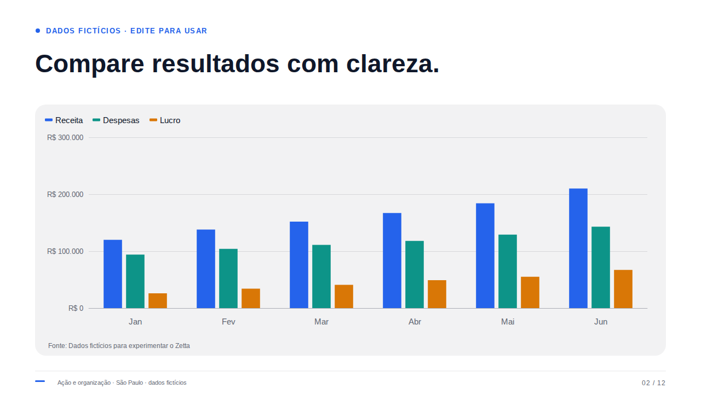
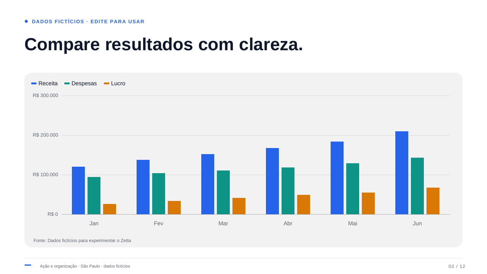

# PDF pesquisável e renderer — prova da v0.3

**Data da prova: 22/10/2026.** A exportação do [fixture editável de 12 slides](pdf-proof.zetta.json) produziu o [PDF pesquisável de referência](searchable-proof.pdf), com texto Unicode, fontes incorporadas, seis gráficos ECharts vetoriais e quatro diagramas vetoriais. Todos os dados são fictícios.

Esta pasta registra a prova específica do renderer e da exportação. Ela complementa os testes da aplicação; não afirma conformidade PDF/UA, cobertura de todos os caracteres Unicode ou igualdade de pixels entre navegadores e leitores de PDF.

## Evidências incluídas

| Arquivo                                      | Conteúdo                                                                                                                 |
| -------------------------------------------- | ------------------------------------------------------------------------------------------------------------------------ |
| [searchable-proof.pdf](searchable-proof.pdf) | PDF final, 12 páginas, 374.611 bytes                                                                                     |
| [pdf-proof.zetta.json](pdf-proof.zetta.json) | Backup completo que pode ser importado no Zetta; inclui marca, imagem e recorte                                          |
| [pdf-inspection.json](pdf-inspection.json)   | Texto, desenhos vetoriais e imagens efetivamente colocadas por página; verificações literais; comparação das capturas    |
| [pdf-reports.json](pdf-reports.json)         | Relatórios reais retornados pelo exportador nos modos pesquisável, imagem e legado; falha de glifo e requests observados |
| [animation.json](animation.json)             | Animações CSS observadas em execução nos seis gráficos com fonte de marca                                                |
| [chart-browser.png](chart-browser.png)       | Slide 2 renderizado pelo mesmo `SlideCanvas` no Chromium, 1280 × 720                                                     |
| [chart-pdf.png](chart-pdf.png)               | Página 2 do PDF renderizada pelo Poppler a 96 dpi, 1280 × 720                                                            |

O PDF foi copiado sem alteração, e o backup conserva o mesmo conteúdo da prova original; os JSON receberam somente formatação. Seus SHA-256 são:

```text
searchable-proof.pdf
6a86e9a317b4e573557936378720838fa5f076dea7eb71f1b2dc0c9b620f5c20

pdf-proof.zetta.json
0acb373107f7155d96ae41f286a006f0d0af5c56db1d158fed5a898825a01952
```

Uma nova exportação pode ter hash ou tamanho diferente por causa dos metadados e identificadores do PDF. Os critérios de reprodução são conteúdo, geometria, fontes, número de páginas e exceções informadas.

## Resultado por conteúdo

Todas as páginas medem **960 × 540 pontos**, proporção 16:9. A inspeção usa `get_image_info()` do PyMuPDF para contar imagens realmente colocadas: a lista global de recursos de uma página pode conter imagens que ela não desenha.

| Página | Conteúdo da prova                                    | Texto extraível | Imagens colocadas |
| ------ | ---------------------------------------------------- | --------------- | ----------------- |
| 1      | Capa, português, moedas e imagem enviada com recorte | Sim             | 1                 |
| 2      | Colunas, três séries                                 | Sim             | 0                 |
| 3      | Barras horizontais                                   | Sim             | 0                 |
| 4      | Linhas                                               | Sim             | 0                 |
| 5      | Área com valor negativo                              | Sim             | 0                 |
| 6      | Pizza                                                | Sim             | 0                 |
| 7      | Rosca                                                | Sim             | 0                 |
| 8      | Processo                                             | Sim             | 0                 |
| 9      | Linha do tempo                                       | Sim             | 0                 |
| 10     | Comparação                                           | Sim             | 0                 |
| 11     | Indicadores com valores literais                     | Sim             | 0                 |
| 12     | Marca com serif e ilustração decorativa              | Sim             | 1                 |

As páginas 2–11 contêm desenhos vetoriais e texto, sem uma imagem do gráfico ou do diagrama. A imagem da página 1 conserva `x=75`, `y=20` e `zoom=1,8`. Os limites geométricos brutos dessa imagem ultrapassam o quadro porque o recorte usa um caminho de clipping; o conteúdo visível permanece dentro do quadro.

A extração recuperou exatamente, entre outros, `Ação, visão e`, `organização.`, `R$ 1.234,56`, `-8,5%`, `€ 24,99`, `R$ -6.000`, `18,5%`, `22/10/2026`, `R$ 1.250,75` e `Fonte: Dados fictícios de verificação`. Isso verifica acentos, sinal negativo, separadores brasileiros, símbolos de moeda, datas e valores visíveis. Os resultados literais estão em [pdf-inspection.json](pdf-inspection.json).

## Quatro fontes incorporadas

As fontes são arquivos estáticos oficiais **Liberation 2.1.5**, não modificados, sob **SIL Open Font License 1.1**. O mesmo TTF usado pela `FontFace` do navegador é registrado no jsPDF. A inspeção dos quatro arquivos encontrou `fsType=0`.

| Família no documento | Peso         | Arquivo local                                                                    |
| -------------------- | ------------ | -------------------------------------------------------------------------------- |
| Liberation Sans      | Regular, 400 | [LiberationSans-Regular.ttf](../../../public/fonts/LiberationSans-Regular.ttf)   |
| Liberation Sans      | Negrito, 700 | [LiberationSans-Bold.ttf](../../../public/fonts/LiberationSans-Bold.ttf)         |
| Liberation Serif     | Regular, 400 | [LiberationSerif-Regular.ttf](../../../public/fonts/LiberationSerif-Regular.ttf) |
| Liberation Serif     | Negrito, 700 | [LiberationSerif-Bold.ttf](../../../public/fonts/LiberationSerif-Bold.ttf)       |

A [licença das fontes](../../../public/fonts/Liberation-LICENSE.txt) acompanha os arquivos. `pdffonts` identificou quatro faces **CID TrueType**, codificação **Identity-H**, com **`emb=yes` e `uni=yes`**. O comando mostra o mesmo nome de família para as faces regular e negrita; os arquivos acima definem os pesos registrados.

Uma marca nova usa a mesma família local no editor, na apresentação e no PDF. Documentos antigos preservam Arial/Georgia no editor. No PDF pesquisável, a substituição por Liberation Sans/Serif é informada ao usuário e em `warnings`; o documento não é alterado. O modo imagem preserva a aparência renderizada sem precisar tornar o texto selecionável.

## Fidelidade e limites do fallback

A saída usa **jsPDF 4.2.1**, **svg2pdf.js 2.8.1** e o mesmo SVG do `SlideCanvas`. O snapshot ECharts usa **6.1.0**. Para manter a posição de textos, a cópia SVG de exportação normaliza duas propriedades que o conversor não reproduzia: `dominant-baseline` vira um deslocamento medido no navegador; `letter-spacing` vira `textLength`.

O conversor apresentou diferenças visíveis na transparência variável de gradientes e na fase dos traços da órbita das ilustrações procedurais. A solução preserva **somente os SVG decorativos como PNG a 2× a dimensão do bloco**, mantendo o recorte externo. As cinco ilustrações atuais usam esse gradiente: orbit, layers, growth, waves e grid. No fixture, a exceção ocorre na página 12.

Cada ocorrência é registrada em `rasterizedElements` e `warnings`. **Texto, gráficos ECharts, diagramas e formas comuns continuam vetoriais.** Fotos e logos enviados permanecem imagens incorporadas. Não há conversão silenciosa de uma página inteira quando o modo pesquisável falha.

O exportador também impede download parcial: conteúdo que não cabe, recurso não carregado, imagem inválida, glifo ausente ou elemento sem conversão suportada produz erro claro. O teste com `🦋`, ausente nas fontes incorporadas, bloqueou o modo pesquisável e orientou escolher o modo imagem. O backup Zetta continua sendo a fonte editável; o PDF não substitui esse arquivo.

### Comparação do gráfico

**Referência do navegador:**



**Mesma página no PDF, renderizada pelo Poppler:**



As 12 páginas foram renderizadas. Nove páginas possuem comparação quantitativa entre capturas no relatório. Na página 2, o erro médio absoluto dos canais RGB foi **2,217 em 255**; **2,369%** dos pixels diferiram em mais de 20 em algum canal. Esses números descrevem a prova, não constituem um limite geral de qualidade. Fontes, linhas e bordas podem apresentar antialiasing diferente entre Chromium e Poppler.

## Outros caminhos conferidos

O modo imagem foi verificado em uma cópia com as páginas originais 1, 2 e 12: resultou em **três páginas, uma imagem de página inteira por página e zero caracteres extraíveis**. O caminho legado foi verificado com duas páginas, uma Arial e outra Georgia, e informou as substituições. Esses PDFs auxiliares não foram incluídos; os relatórios e contagens estão nos JSON desta pasta.

A home vazia não solicitou ECharts, svg2pdf ou fontes de marca. Os helpers de layout e avisos são puros em `chartLayout.ts`; o engine entra por `chartRuntime.ts` quando existe gráfico visível. A exportação faz preload dos gráficos e falha explicitamente se o carregamento não terminar.

Em um componente React montado no Chromium, os seis tipos com fonte de marca tiveram animações CSS em estado `running`, sem `pageerror`. Os nomes em [animation.json](animation.json) incluem o escopo da instância e do replay. Os quadros finais foram comparados ao estático; há diferenças residuais de composição/antialiasing, sobretudo no texto das legendas radiais, portanto não se promete igualdade pixel a pixel. A preferência de movimento reduzido é controlada pelo Presenter.

## Reprodução pela interface

Execute estes comandos **na raiz do repositório**, com Node.js e npm preparados:

```bash
npm ci
npm run build
npm run preview -- --port 4173
```

1. Abra `http://localhost:4173`.
2. Na tela inicial, clique em **Importar backup** e selecione [pdf-proof.zetta.json](pdf-proof.zetta.json).
3. Confirme que a apresentação tem **12 slides**. Os gráficos estão nos slides 2–7; os diagramas, nos slides 8–11; o slide 12 usa a família serif.
4. Aguarde a fonte e os gráficos ficarem visíveis. Abra o slide 2 e compare com [chart-browser.png](chart-browser.png). Use **Apresentar** e **Repetir animação** para conferir a entrada do gráfico.
5. Volte ao editor, clique em **Baixar PDF** e depois em **Exportar PDF pesquisável**.
6. O relatório deve informar o fallback da ilustração decorativa do slide 12. Neste fixture não deve haver aviso de substituição de fonte legada, pois todas as páginas usam marcas com fontes locais.
7. Abra o PDF, selecione e copie texto e confira as doze páginas. Para verificar o modo de página inteira em imagem, repita a exportação escolhendo **Exportar PDF como imagem**.

O fixture foi validado também por `parseDeckImport` antes de ser incluído: **12 slides, seis tipos de gráficos, quatro tipos de diagramas e marcas sans/serif**. A importação pode criar novo identificador e datas no aplicativo; o conteúdo e a aparência são mantidos.

## Inspeção técnica reproduzível

Os comandos abaixo usam **Poppler** (`pdfinfo`, `pdffonts`, `pdftotext`, `pdftoppm`). Execute-os na raiz do repositório. A extração de texto para `-` escreve na saída padrão.

```bash
pdfinfo docs/validation/v0.3/searchable-proof.pdf
pdffonts docs/validation/v0.3/searchable-proof.pdf
pdftotext -layout docs/validation/v0.3/searchable-proof.pdf -
```

Para regenerar a imagem da página 2, a 96 dpi:

```bash
mkdir -p artifacts/pdf-validation
pdftoppm -f 2 -l 2 -singlefile -png -r 96 docs/validation/v0.3/searchable-proof.pdf artifacts/pdf-validation/chart-pdf
```

Para contar texto, desenhos e imagens colocadas, em um ambiente Python com **PyMuPDF** disponível:

```bash
python - <<'PY'
import fitz

pdf = fitz.open('docs/validation/v0.3/searchable-proof.pdf')
for index, page in enumerate(pdf, start=1):
    print({
        'page': index,
        'size_points': list(page.rect),
        'characters': len(page.get_text()),
        'vector_drawings': len(page.get_drawings()),
        'placed_images': len(page.get_image_info()),
    })
PY
```

As ferramentas de inspeção são usadas apenas na verificação; o aplicativo exporta no navegador e não depende de Python, Poppler ou de servidor de conversão.

## Checagens de código executadas nesta prova

```bash
npx tsc --noEmit
npx vitest run tests/diagramLayout.test.ts tests/pdfPlan.test.ts tests/chartRenderer.test.ts tests/chartDocument.test.ts tests/generator.test.ts
```

O TypeScript passou e os **92 testes focados passaram**. Dez testes novos verificam preservação dos campos dos diagramas, avisos sem ocultação de itens, quebra de texto, plano de fontes e snapshots de aparência. Essa contagem se refere à rodada focada do renderer, não à soma final de todos os testes da versão.

Os pontos centrais da implementação são [exportPdf.ts](../../../src/lib/exportPdf.ts), [SlideCanvas.tsx](../../../src/components/SlideCanvas.tsx), [fonts.ts](../../../src/lib/fonts.ts), [diagramLayout.ts](../../../src/lib/diagramLayout.ts), [chartLayout.ts](../../../src/lib/chartLayout.ts), [chartRuntime.ts](../../../src/lib/chartRuntime.ts) e [InlineChartSvg.tsx](../../../src/components/InlineChartSvg.tsx). Nenhum arquivo-fonte foi alterado durante esta consolidação documental.
